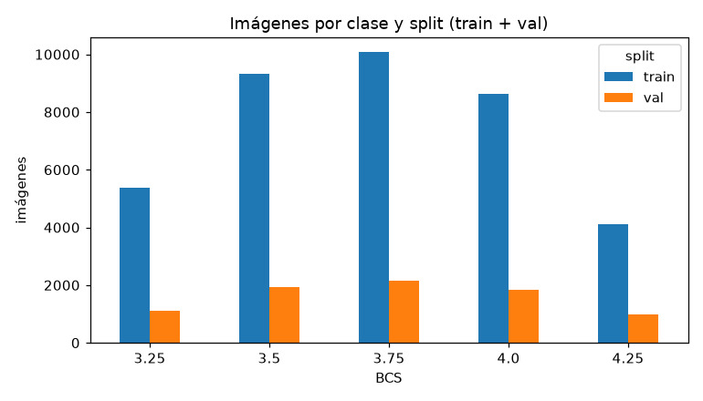
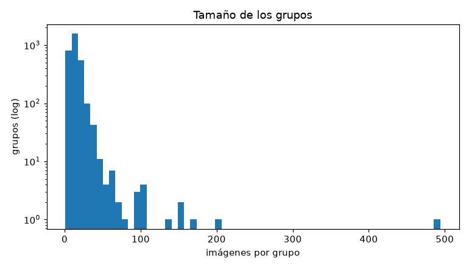
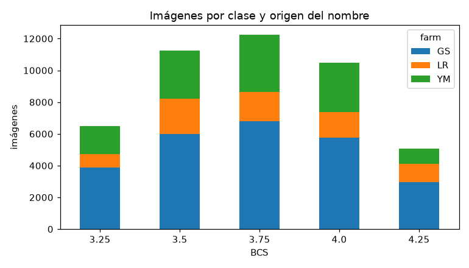
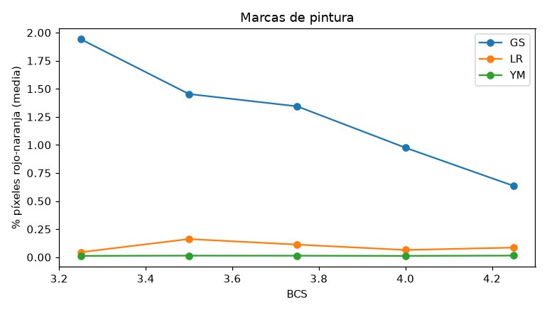

# Reporte de datos · T06 (para G1)

Fuente única `sdb_bcs` (G0 punto 2), preprocesada según `preprocesamiento/README.md` (T03).
Split train / val / test de `preprocesamiento/split.csv` tal cual (G0 punto 3); test es el
holdout y **no aparece en nada de este reporte**: todos los números son de train + val.

Reproducir:

```sh
make labels                                  # labels.csv, splits.csv, holdout_groups.txt, sources.lock.json
uv run python -m bcs.data.merge report       # números, gráficos y hojas de contactos
```

Los números salen de `~/bcs-shared/runs/T06/data_numbers.md` (lo escribe `report`; las tablas de
abajo están copiadas de ahí). La medida de pintura por imagen queda en
`~/bcs-shared/runs/T06/paint_frac.csv`.

## 1. Qué escribe `make labels`

| archivo en `$BCS_DATA_DIR` | contenido |
|---|---|
| `labels.csv` | unión de los `labels_<id>.csv` de escala 1–5 (hoy solo `labels_sdb_bcs.csv`): **45.523** filas, esquema de `bcs.data.schema`, ordenadas por `image_id` |
| `splits.csv` | `image_id,split` para cada fila de `labels.csv`: **37.495 train / 8.028 val** |
| `holdout_groups.txt` | los **545** `group_id` con `split=test` en `preprocesamiento/split.csv` |
| `sources.lock.json` | unión de los `sources.lock.<id>.json` (hoy solo `sdb_bcs`, DOI 10.57760/sciencedb.16704, sha256 del `.rar`) |

Antes de escribir, `make labels` verifica (y si algo falla no escribe nada):

- que `splits_<id>.csv` del adaptador coincida imagen por imagen con `preprocesamiento/split.csv`;
- que ningún `group_id` aparezca en dos splits (train / val / test);
- que ningún grupo de `holdout_groups.txt` esté en `labels.csv`;
- que cada fila de `labels.csv` tenga split y sea train o val.

Los `holdout_labels_<id>.csv` no se leen nunca (los grupos de test salen de `split.csv`).
`make labels` es idempotente: una segunda corrida no reescribe archivos.

## 2. Imágenes por clase y split



| BCS | train | val | total | % |
|---|---|---|---|---|
| 3.25 | 5.360 | 1.111 | 6.471 | 14,2 |
| 3.5 | 9.313 | 1.922 | 11.235 | 24,7 |
| 3.75 | 10.082 | 2.163 | 12.245 | 26,9 |
| 4.0 | 8.643 | 1.848 | 10.491 | 23,0 |
| 4.25 | 4.097 | 984 | 5.081 | 11,2 |
| **total** | **37.495** | **8.028** | **45.523** | |

- Rango 3.25–4.25, paso 0.25 (G0 punto 4). Las colas (3.25 y 4.25) tienen la mitad de imágenes que
  el centro, pero ninguna clase baja de las 15 imágenes que dispararían `collapse_below/above`.
- La proporción por clase es casi la misma en train y val (val = 17–19% de cada clase).

## 3. Animales y grupos

| BCS | imágenes | animales | grupos | grupos train | grupos val |
|---|---|---|---|---|---|
| 3.25 | 6.471 | 700 | 670 | 556 | 114 |
| 3.5 | 11.235 | 1.232 | 1.144 | 948 | 196 |
| 3.75 | 12.245 | 1.367 | 1.224 | 999 | 225 |
| 4.0 | 10.491 | 1.168 | 1.070 | 877 | 193 |
| 4.25 | 5.081 | 498 | 479 | 386 | 93 |



- **3.102 grupos, 4.850 animales** (`animal_id`) en train + val. Hay menos grupos que animales
  porque el `group` del README junta `GS_<n>` e `YM_<n>` con el mismo número en `cow_<n>`
  (agrupar de más es seguro para la fuga).
- **1.457 grupos tienen más de una clase** (la misma vaca filmada en otra condición corporal).
  Por eso el conteo de grupos por clase suma más que 3.102.
- Imágenes por grupo: mediana 13, cola larga. **Un solo tramo, `LR_seg167`, tiene 494 imágenes,
  todas 4.25** (≈ 10% de la clase 4.25, 247 L + 247 R); le siguen otros tramos L/R de 150–200.
  Recomendación para entrenamiento (T09+): pesar o muestrear por grupo para que un tramo de video
  no domine una clase.

## 4. Origen del nombre (GS / YM / L-R) × clase



| origen | 3.25 | 3.5 | 3.75 | 4.0 | 4.25 | total |
|---|---|---|---|---|---|---|
| GS | 3.899 | 5.986 | 6.792 | 5.768 | 2.966 | 25.411 |
| L-R | 830 | 2.212 | 1.852 | 1.594 | 1.128 | 7.616 |
| YM | 1.742 | 3.037 | 3.601 | 3.129 | 987 | 12.496 |

- Los tres orígenes cubren las cinco clases con perfiles parecidos; L-R tiene relativamente
  pocas 3.25 (11% vs 15% en GS y 14% en YM).
- Se ven distintos (hojas de contactos, §6): **GS** vista trasera desde arriba, Holando
  blanco y negro, muchas con pintura en la base de la cola; **YM** vista trasera, imagen más
  lavada / poco saturada, sin pintura visible; **L-R** vistas oblicuas trasero-laterales (cámara
  izquierda / derecha) más cerradas, con varias vacas de manchas marrón claro.
- El texto sobreimpreso está tapado en negro (T03); los rectángulos negros se ven en algunos
  recortes de GS e YM.

## 5. Fuga conocida del split (G0 punto 7, opción A)

El `split.csv` del README deja casi-duplicados entre splits: tramos L-i/R-i cortados en huecos de
la numeración (frames contiguos del mismo video en grupos `LR_seg` distintos) y vacas GS con dos
IDs. Medido por T03: 784 pares con dHash ≤ 4 entre splits; 109 pares con correlación de píxeles
≥ 0,9 (75 imágenes) y 256 imágenes con ≥ 0,8, < 0,5% del total. Por decisión del humano se deja
tal cual; está documentado en `raw/sdb_bcs_pre/preprocess_manifest.json` (`known_leakage`) y en
`images/sdb_bcs/qa_sdb_bcs.json`, con evidencia en `~/bcs-shared/runs/T03/leak_evidence/`.
**Las métricas de val (y de test) pueden estar levemente infladas.** `make labels` no cambia
esto: sus chequeos son por `group_id`, y estas parejas están en grupos distintos.

## 6. Posible atajo: marcas de pintura en la base de la cola

T03 vio pintura roja / naranja en la base de la cola de muchas vacas GS (marcas de detección de
celo o de manejo). Si la pintura correlaciona con la clase, un modelo puede aprender "pintura →
flaca" en vez de la forma del anca.

**Medida.** Fracción de píxeles de cada recorte procesado (el mismo que ve el modelo) con color
rojo-naranja saturado: HSV de PIL, tono < 18 o > 241 (≈ 0–25° / 340–360°), saturación > 128,
valor > 77. "Pintada" = más de 0,5% del recorte. Además, una medida de amarillo saturado
(tono 18–35, ≈ 25–50°) porque en las hojas aparecen marcas amarillas / ocre.



| origen | BCS | n | % píxeles rojos (media) | p90 | **% imágenes pintadas** | % píxeles amarillos | % con amarillo |
|---|---|---|---|---|---|---|---|
| GS | 3.25 | 3.899 | 1,94 | 5,82 | **49,0** | 1,65 | 34,4 |
| GS | 3.5 | 5.986 | 1,45 | 4,93 | **41,3** | 1,34 | 31,5 |
| GS | 3.75 | 6.792 | 1,34 | 4,40 | **39,2** | 1,29 | 31,0 |
| GS | 4.0 | 5.768 | 0,98 | 3,52 | **31,8** | 1,23 | 31,9 |
| GS | 4.25 | 2.966 | 0,64 | 2,55 | **20,2** | 1,19 | 32,8 |
| L-R | 3.25 | 830 | 0,04 | 0,13 | 1,3 | 0,29 | 4,2 |
| L-R | 3.5 | 2.212 | 0,16 | 0,34 | 7,7 | 0,87 | 19,9 |
| L-R | 3.75 | 1.852 | 0,11 | 0,07 | 5,0 | 0,70 | 16,4 |
| L-R | 4.0 | 1.594 | 0,06 | 0,11 | 3,1 | 1,24 | 26,9 |
| L-R | 4.25 | 1.128 | 0,09 | 0,16 | 5,5 | 0,55 | 12,1 |
| YM | 3.25 | 1.742 | 0,01 | 0,02 | 0,3 | 0,00 | 0,0 |
| YM | 3.5 | 3.037 | 0,01 | 0,03 | 0,3 | 0,00 | 0,0 |
| YM | 3.75 | 3.601 | 0,01 | 0,03 | 0,3 | 0,00 | 0,0 |
| YM | 4.0 | 3.129 | 0,01 | 0,02 | 0,2 | 0,00 | 0,0 |
| YM | 4.25 | 987 | 0,01 | 0,03 | 0,2 | 0,00 | 0,2 |

Correlación de Spearman entre la fracción roja y el BCS: GS −0,177 por imagen y −0,184 por grupo
(media del grupo); L-R −0,080 / +0,172; YM +0,018. AUC de la fracción roja sola para separar
BCS ≤ 3.5 de ≥ 3.75: GS 0,576, L-R 0,546, YM 0,495.

**Lo que se ve en las hojas.** `red_top.jpg` (las 36 imágenes con más rojo) y
`painted_sample.jpg` (36 pintadas al azar) son casi todas GS con una franja de pintura roja
o naranja sobre la base de la cola y el sacro: la medida agarra la pintura, no otra cosa. Las
pocas "pintadas" de L-R son falsos positivos (pelaje marrón rojizo, p. ej. `L-i6366`, o algún
objeto rojo del fondo). La medida amarilla mezcla pintura ocre real en GS (p. ej. `GS_2385_2`,
`GS_2578_10`) con pelaje marrón claro y bosta en L-R, por eso en L-R es ruido.

**Conclusión (va a G1): la pintura roja correlaciona con la clase en GS.** La fracción de vacas
GS pintadas baja de forma monótona de 49% en 3.25 a 20% en 4.25, y la cantidad de rojo cae a
un tercio. La pintura amarilla no muestra tendencia (31–34% en todas las clases). Por sí sola la
pintura roja separa poco (AUC 0,58), pero es una señal fácil y estable que un modelo puede
aprender. En la práctica marca a la vaca, no a la foto: en los 30 grupos GS con más de una clase
la tasa de pintura casi no cambia entre la clase más baja y la más alta de la misma vaca (análisis
de una vez, no está en el código). Es decir, en esta granja las vacas más flacas son las
pintadas (plausible: lactancia temprana / servicio), y eso no se va a cumplir en otro rodeo.

Opciones para decidir en G1 (no las implemento acá):

1. Entrenar igual y medir el atajo: MAE en val de GS pintadas vs no pintadas por clase, y
   predicción sobre la misma imagen con la franja de pintura tapada o desaturada.
2. Aumento de datos: desaturar / cambiar el tono de los píxeles rojo-naranja al entrenar (o
   pintar franjas falsas en vacas no pintadas) para romper la correlación.
3. Pesar las muestras de GS para igualar la tasa de pintura entre clases.

## 7. Hojas de contactos

No se commitean (imágenes de terceros); están en `~/bcs-shared/runs/T06/contact_sheets/`. Solo
train + val, semilla 42.

| archivo | contenido |
|---|---|
| `bcs_<clase>.jpg` | 30 recortes al azar de la clase (los tres orígenes) |
| `bcs_<clase>_<GS\|LR\|YM>.jpg` | 18 recortes al azar de la clase y el origen (15 hojas) |
| `red_top.jpg` | las 36 imágenes con más fracción roja |
| `painted_sample.jpg` | 36 imágenes "pintadas" al azar |

Lo que vi:

- **3.25** (`bcs_3.25.jpg`): muchas GS con pintura roja o naranja en la base de la cola; ancas
  angulosas, huesos de la cadera marcados. Algunos recortes de L-R son tan cerrados u oblicuos que
  el anca casi no se reconoce (p. ej. `R-i2008`, `L-i5479`), y varios de YM están borrosos:
  conviene que el filtro de calidad (T08) los mire.
- **4.25** (`bcs_4.25.jpg`): menos pintura roja, más marcas ocre / amarillas; ancas más
  redondeadas. Muchas L-R con manchas marrón claro.
- **YM** (`bcs_3.75_YM.jpg`): vista trasera, poca saturación, sin pintura; algunos recortes
  con el rectángulo negro del texto tapado dentro del anca.
- **L-R** (`bcs_4.0_LR.jpg`): vistas oblicuas, recorte cerrado sobre el anca y el muslo, con
  barandas del brete; ninguna pintura.

## 8. Pendiente / riesgos para G1

- Atajo de pintura roja en GS (§6): decidir mitigación antes de entrenar en serio.
- Grupos muy grandes (`LR_seg167` = 494 imágenes de 4.25): pesar por grupo.
- Fuga conocida (§5): las métricas de val están levemente infladas.
- Recortes muy cerrados u oblicuos (L-R) y borrosos (YM): los puede mirar T08.
